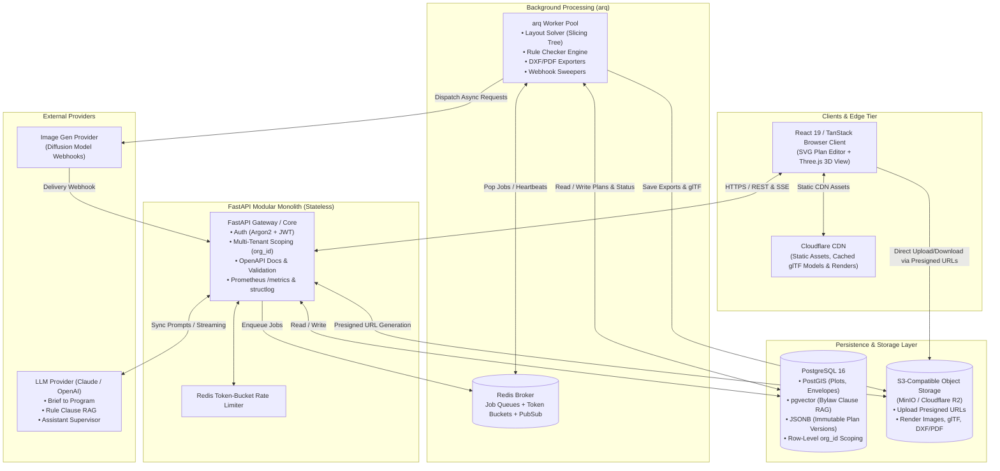
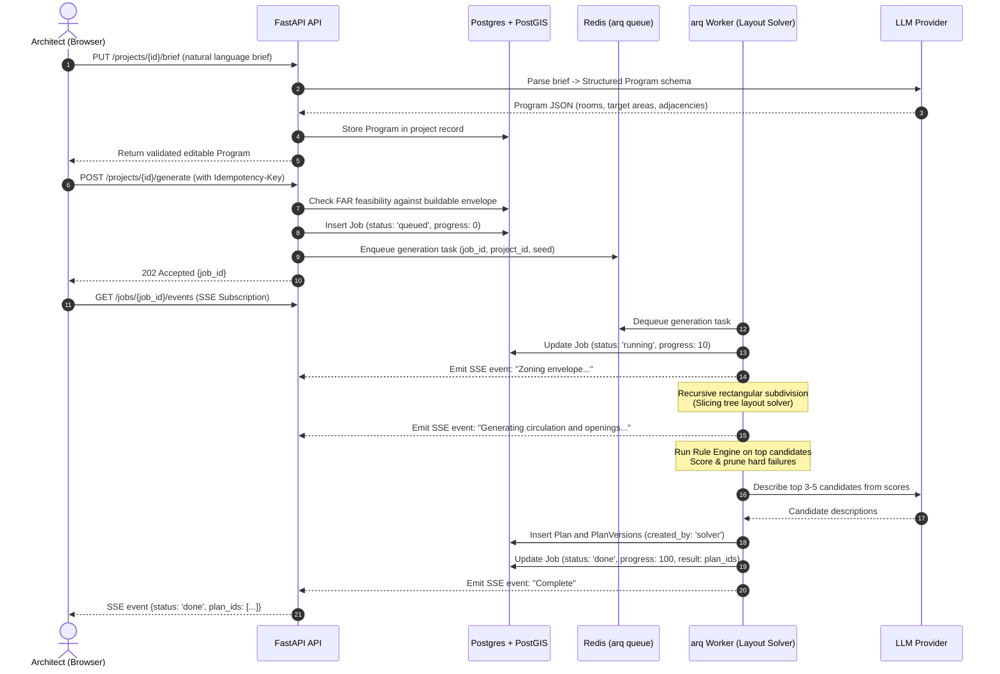
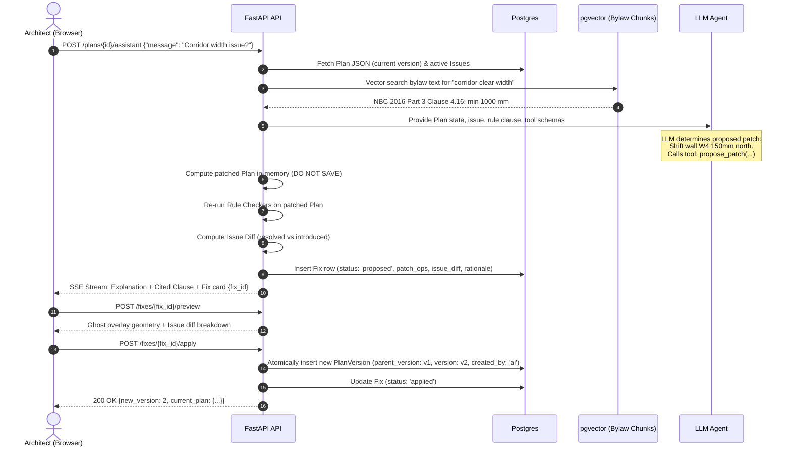
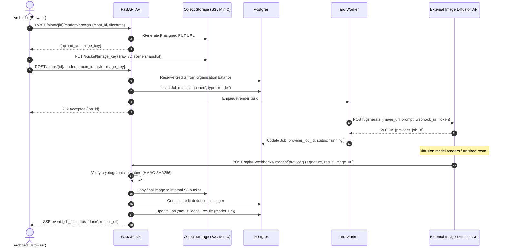

# System Design Document — AI Home Design Platform for Architects

> **Architecture Style:** Modular Monolith (FastAPI + Async Worker + PostgreSQL/PostGIS/pgvector + Redis + Object Storage)  
> **Source of Truth:** [CLAUDE.md](../CLAUDE.md)

---

## 1. Requirements and System Scope (Chapter 03 Framework: Step 1)

### 1.1 Functional Requirements

The platform delivers the end-to-end architect workflow through the core product loop:
$$\text{Observe} \longrightarrow \text{Flag} \longrightarrow \text{Propose} \longrightarrow \text{Apply}$$

1. **Plot Definition:**
   - Draw cadastral plot boundary polygon on an OSM map or specify explicit width $\times$ depth dimensions in millimetres.
   - Orient North angle (degrees) and annotate road-facing boundary edges with road width.
   - Store geometry in metric coordinates ($mm$) in PostGIS.
2. **Rulesets & Buildable Envelope:**
   - Select jurisdiction building bylaws (e.g., India NBC 2016 Part 3, Uttar Pradesh, Uttarakhand bylaws).
   - Compute the 3D legally buildable envelope: front/rear/side setback offsets, maximum ground coverage ($m^2$), Floor Area Ratio (FAR / FSI), and maximum permissible height / floor count.
   - Trace all envelope limits back to verified rule citations (`document`, `clause`, `severity`).
3. **Brief Structuring & Program:**
   - Convert natural language client briefs ("3BHK, 2 floors, vastu compliant, east entry, home office") into a structured, validated architectural program (room types, target areas, adjacencies, orientation constraints).
   - Feasibility pre-check: verify total program area against FAR limits prior to layout solving.
4. **Layout Generation (Solver):**
   - Deterministic procedural rectangular subdivision (slicing tree) of the envelope footprint.
   - Zoned layout: public $\rightarrow$ private $\rightarrow$ service, circulation corridors, vertical stair alignment across levels.
   - Produce 3 to 5 scored, rule-checked candidates within 30 seconds.
5. **Interactive Plan Workspace (2D):**
   - High-fidelity SVG floor plan viewer/editor with live millimeter dimensioning and cursor coordinate readouts.
   - Atomic, typed patch operations (`move_wall`, `resize_opening`, `split_room`, `rename_room`).
   - Immutable version tree: every edit creates a new Plan Version with undo/redo and visual diffing.
6. **Rule Review Engine:**
   - Pure Python rule checkers: minimum room areas, widths, ceiling heights, corridor/door clearances, stair risers/treads, window-to-floor ventilation ratios, envelope containment.
   - Status classifications: **Pass**, **Review** (for unverified or warning rules), **Fail**.
   - Review console with click-to-highlight directly focusing on the offending element.
7. **Overlay Assistant:**
   - Single-agent tool-calling loop (RAG over bylaw clauses, plan querying, measurement, automated fix proposal).
   - **Propose, Never Apply:** Assistant proposes a `Fix` object with computed side-effects and diffs. The user explicitly applies or skips.
8. **3D Extrusion & Walkthrough:**
   - Automatic browser-side 3D model generation (Three.js / WebGL) with wall cutaways, level switcher, and time-of-day solar path simulation based on plot north.
   - Bi-directional selection sync between 2D plan and 3D viewport.
9. **Interior Visualization:**
   - Camera placement in 3D $\rightarrow$ clean perspective snapshot $\rightarrow$ presigned S3 upload $\rightarrow$ async diffusion rendering job.
   - Style presets (Modern Minimal, Scandinavian, Indian Contemporary, etc.) with interactive before/after comparison slider.
10. **Cadastral & BIM Exports:**
    - Cadastral-ready DXF export with distinct CAD layers (`A-WALL`, `A-DOOR`, `A-GLAZ`, `A-DIMS`, `A-ROOM-ID`).
    - Multi-page architectural PDF sheets with title block, room schedule, and compliance audit trail.
    - glTF 3D scene export.

### 1.2 Non-Functional Requirements & Service Level Objectives (SLOs)

- **Latency Targets:**
  - Interactive API requests (CRUD, Patches, Diff): $p95 < 150\,\text{ms}$, $p99 < 300\,\text{ms}$.
  - Plan review check ($100$ rules): $p95 < 250\,\text{ms}$.
  - Async plan generation (2-floor 4BHK): $p95 < 30\,\text{s}$.
  - Interior render webhook/delivery: $p95 < 60\,\text{s}$.
- **Availability:** $99.9\%$ uptime for REST API and asset delivery.
- **Data Integrity:** Strict multi-tenancy isolation by `org_id` enforced in the database repository layer. Zero cross-tenant data leakage. Plan version trees are append-only and immutable.
- **Auditability:** Every geometric patch, AI fix proposal, rule override, and render is timestamped and attributed to `created_by: user | ai | solver`.
- **Cost Boundaries:** Hard spending caps, token tracking, and rate limiting per organization.

---

## 2. Back-of-the-Envelope Estimates (Chapter 02 Framework: Step 2A)

### 2.1 Assumptions & Scale (Targeting Year 1 Growth)
- **Active Organizations:** $2,000$ architectural studios / firms.
- **Active Users:** $10,000$ architects ($5$ users/org average).
- **Projects per User per Year:** $12$ projects $\implies 120,000$ projects/year ($10,000$ new projects/month).
- **Working Days:** $250$ days/year ($20$ days/month).

### 2.2 Plan Data & Versioning Storage
- **Single Plan JSON Size:**
  - A typical 2-floor 4BHK plan contains $\sim 15$ rooms, $\sim 45$ walls, $\sim 20$ openings, $\sim 2$ stairs.
  - JSON payload size $\approx 50\,\text{KB}$.
- **Versions per Project:**
  - Initial generation: $5$ candidate versions.
  - User and AI patch edits: $\sim 35$ versions over the project lifecycle.
  - Total versions/project: $40$ versions.
  - Compressed delta/full JSON per project $\approx 40 \times 30\,\text{KB} \approx 1.2\,\text{MB}$.
  - Monthly Plan JSON storage growth: $10,000 \times 1.2\,\text{MB} \approx 12\,\text{GB}/\text{month}$.

### 2.3 Compute & Traffic Throughput
- **Plan Generation Jobs:**
  - $10,000$ projects/month $\times 3$ generation runs/project $= 30,000$ jobs/month.
  - Per day: $30,000 / 20 \text{ working days} = 1,500$ generation jobs/day.
  - Peak hours ($8\text{ hrs}$): $1,500 / (8 \times 3600) \approx 0.052\,\text{jobs/s}$ (Burst: $\sim 1\,\text{job/s}$).
- **Interior Renders:**
  - $4$ rooms rendered per project $\times 3$ style iterations $= 12$ renders/project.
  - $10,000$ projects $\times 12 = 120,000$ renders/month.
  - Per day: $120,000 / 20 = 6,000$ renders/day ($\sim 0.21\,\text{renders/s}$, peak burst: $\sim 2\,\text{renders/s}$).
- **Object Storage Growth:**
  - Input base render: $1\,\text{MB}$ PNG.
  - Output diffusion render: $2\,\text{MB}$ WebP.
  - glTF 3D binary: $1.5\,\text{MB}$ per project version.
  - DXF & PDF export: $2\,\text{MB}$ per project.
  - Monthly media storage:
    $$120,000 \text{ renders} \times 3\,\text{MB} + 10,000 \text{ projects} \times (1.5 + 2)\,\text{MB} = 360\,\text{GB} + 35\,\text{GB} \approx 395\,\text{GB}/\text{month} \approx 4.74\,\text{TB}/\text{year}$$

### 2.4 LLM Token & Inference Costs
- **Brief Structuring:** $1$ call $\times (1,500\text{ input tokens} + 800\text{ output tokens}) \approx \$0.005$
- **Option Summaries:** $5$ descriptions $\times 300\text{ tokens} \approx \$0.003$
- **Assistant Chat & Fixes:** $20$ turns/project $\times (2,000\text{ context tokens} + 500\text{ response tokens}) \approx 20 \times \$0.008 = \$0.16$
- **Total LLM cost per project:** $\approx \$0.18 - \$0.25$
- **Image Generation Cost:** $12$ renders $\times \$0.03/\text{render} \approx \$0.36$
- **Total AI infrastructure cost per project:** $\approx \$0.55 - \$0.65$

---

## 3. High-Level System Architecture (Chapter 03: Step 2)

---

## 4. Key Data Flows (Chapter 03: Step 3)

### 4.1 Plan Generation Job Flow

### 4.2 Assistant Fix Proposal & Safe Application Flow

### 4.3 Interior Render via Webhook Flow

---

## 5. Scaling Strategy (Chapter 01 & Chapter 03: Step 4)

We begin as a **Clean Modular Monolith** — a single deployable Python FastAPI application accompanied by an `arq` background worker pool. This eliminates distributed system latency, cross-service schema synchronization overhead, and deployment complexity while maintaining strict domain module boundaries.

| Scale Stage | Active Users | Architecture & Optimization Interventions |
|---|---|---|
| **Phase 1 (MVP)** | $1 - 500$ | • Single FastAPI instance + 1 arq worker container. • Single PostgreSQL database with PostGIS + pgvector. • Redis for queues and token bucket rate limits. • MinIO for local S3 simulation; Cloudflare R2 in staging. |
| **Stage 2 (Growth)** | $500 - 10,000$ | • Horizontally autoscale stateless FastAPI API containers (2 to 8 instances). • Dedicated worker pools for compute-heavy tasks (solver vs render/export). • PostgreSQL read replica for analytical queries, ruleset browsing, and version history. • Cloudflare CDN caching for immutable glTF 3D models, SVG assets, and interior render outputs. • Client-side evaluation of lightweight geometry checks where appropriate. |
| **Stage 3 (Scale)** | $10,000 - 100,000+$ | • Dedicated PostGIS / Spatial read cluster. • Sharded Redis clusters for independent rate limiting and queue management. • Dedicated solver workers written in Rust or C++ (wrapping GEOS/CGAL) if Python Shapely becomes CPU-bound. • Partitioned PostgreSQL tables for `plan_versions`, `jobs`, and `usage_events` by `org_id` and date range. |

---

## 6. Failure Modes, Resilience & Graceful Degradation (Chapter 03: Step 4)

1. **LLM Provider Outage or Rate Limit (HTTP 429/503):**
   - *Mitigation:* Exponential backoff with jitter (3 retries).
   - *Fallback:* Circuit breaker opens after 5 consecutive failures. If brief structuring fails, allow user to input requirements via the manual structured program editor without blocking plan generation.
   - *Cost Guard:* Daily token quotas per organization stored in Redis and enforced at the gateway.
2. **External Image Diffusion Webhook Never Arrives:**
   - *Mitigation:* Background sweeper task in `arq` checks every 5 minutes for jobs stuck in `running` state past the 10-minute timeout window.
   - *Remediation:* Mark job `failed` with code `PROVIDER_TIMEOUT`, trigger automatic credit refund in the immutable credit ledger, and notify the user via UI toast/SSE.
3. **Worker Crash Mid-Job (OOM / Node Eviction):**
   - *Mitigation:* `arq` uses Redis message acknowledgment (`in-progress` keys with TTL heartbeat). If a worker process terminates abruptly, unacknowledged jobs are requeued.
   - *Idempotency:* Layout generation uses deterministic seeds; all jobs check `idempotency_key` on startup to avoid duplicate work.
4. **PostgreSQL Connection Exhaustion:**
   - *Mitigation:* Async connection pooling using `asyncpg` with strict `pool_size=20, max_overflow=10` per API instance, plus `pgbouncer` connection pooling in high-concurrency production deployments.
5. **Cross-Tenant Breach Attempt:**
   - *Enforcement:* Zero trust at the service layer. Every database query in the repository layer explicitly requires and filters on `org_id`. Missing or mismatched `org_id` returns HTTP 404 (Never HTTP 403, preventing resource enumeration).
